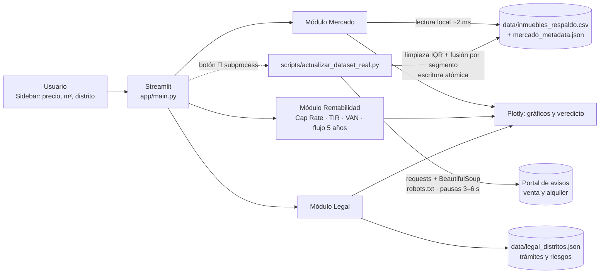

# EVI.IA — Evaluador de Viabilidad de Inversión Inmobiliaria con IA

## 1. One-liner
**Ayudamos a pequeños inversionistas inmobiliarios de Lima a decidir en minutos si un departamento conviene, cruzando precios de mercado scrapeados, un modelo financiero a 5 años y alertas legales de saneamiento por distrito.**

## 2. Founder
<!-- ✏️ PENDIENTE: agrega tu foto en docs/founder.jpg y completa tus datos -->
| | |
|---|---|
|  | **[Tu nombre]** — Estudiante de [carrera], Universidad del Pacífico. _[Una línea sobre por qué eres la persona indicada: p. ej., experiencia en finanzas, familia que invierte en inmuebles, prácticas en una inmobiliaria o banco…]_ |

**Cómo cubro cada rol con agentes de IA**
- **Producto:** defino el flujo a partir de las entrevistas en [docs/research/](docs/research/); Claude Code me ayuda a priorizar.
- **Ingeniería:** Claude Code escribe y revisa el código (scraping, modelo financiero, app Streamlit); yo valido los cálculos y los entiendo línea por línea.
- **Diseño:** Streamlit + Plotly dan una interfaz limpia sin diseñador.
- **Ventas:** uso IA para redactar mensajes a corredores y grupos de inversionistas, y contenido para LinkedIn.

## 3. Problema
**Quién lo sufre:** profesionales y ahorristas de 30 a 55 años que quieren comprar **un** departamento para alquilar en Lince, Jesús María o San Isidro, y que no tienen un analista ni un abogado de cabecera.

**Cómo lo resuelven hoy:** revisan avisos a mano en portales, preguntan al corredor (que gana por vender) y, con suerte, arman un Excel con el alquiler esperado. Las verificaciones legales se hacen tarde, a veces ya con la arras firmada.

**Qué les cuesta:**
- **Horas:** comparar precios por m² de decenas de avisos a mano. _[completar con lo que reporten las entrevistas]_
- **Soles:** costos que suelen omitirse: alcabala (3 % sobre el exceso de 10 UIT), gastos notariales y registrales, predial y arbitrios, vacancia, impuesto a la renta de 1.ª categoría.
- **Errores:** comprar inmuebles con fábrica no declarada, sin independizar o con cargas en SUNARP, cuya regularización puede tomar meses.

**Evidencia — 3 conversaciones con usuarios potenciales:**
| # | Perfil | Hallazgo principal | Notas |
|---|---|---|---|
| 1 | _[completar]_ | _[completar]_ | [entrevista-01.md](docs/research/entrevista-01.md) |
| 2 | _[completar]_ | _[completar]_ | [entrevista-02.md](docs/research/entrevista-02.md) |
| 3 | _[completar]_ | _[completar]_ | [entrevista-03.md](docs/research/entrevista-03.md) |

> ⚠️ Las entrevistas deben ser reales; las plantillas están listas en `docs/research/`.

## 4. Solución e insight
**Qué construimos:** una app web con tres módulos que trabajan sobre el mismo inmueble (precio, m² y distrito ingresados en la barra lateral):

1. **📊 Estudio de mercado:** dataset local de avisos **reales de venta y alquiler** (Lince, Jesús María, San Isidro) que la app lee al instante, sin depender de la red durante el demo. Un script lo actualiza con scraping responsable y la app lo puede lanzar en segundo plano desde la barra lateral, mostrando la **fecha de la última actualización del mercado**. Compara tu precio/m² con la mediana del distrito, calcula la rentabilidad bruta (alquiler/m² ÷ precio/m²) y muestra la distribución por tipología.
2. **💰 Rentabilidad financiera (del inversionista comprador):** mide el retorno de quien **compra para alquilar 5 años y vender al año 5**. Calcula inversión total (precio + alcabala + gastos de cierre + remodelación), **Cap Rate**, NOI, cash-on-cash, **flujo de caja a 5 años**, **TIR**, **VAN** y payback, con un veredicto: viable / con reservas / no viable. Los montos se muestran en **USD y soles (PEN)** según el tipo de cambio de la barra lateral.
3. **⚖️ Alertas legales y permisos:** base local estructurada con los trámites (SUNARP, municipalidad, notaría), sus plazos estimados y los riesgos de saneamiento típicos de cada distrito. Un **formulario de diagnóstico** (antigüedad, independización en SUNARP, uso inscrito vs. previsto, pisos construidos vs. declarados, cargas, deudas, sucesión) calcula un **Score de Riesgo Burocrático (0-100)** con su desglose por factor, y una **ruta crítica** en días con el aporte de **Notaría, SUNARP y Municipalidad** (diagrama de Gantt, escenario optimista o conservador).

**Insight:** el inversionista minorista no pierde dinero por elegir mal el distrito, sino por **lo que no ve en la hoja de cálculo**: costos de transacción, vacancia, impuestos y, sobre todo, **riesgo registral**. Un inmueble "barato" respecto a la mediana suele estar barato por un problema de saneamiento. EVI.IA pone mercado, finanzas y legal en la misma pantalla para que esa conexión salte a la vista.

## 5. Why now
- **Datos abiertos y online:** los portales inmobiliarios concentran miles de avisos públicos y SUNARP ofrece publicidad registral en línea. Hace pocos años esa información estaba dispersa o en papel.
- **Herramientas de una sola persona:** con Python, Streamlit y hosting gratuito, más agentes de código como Claude Code, un founder puede construir y desplegar el producto en días.
- **Más inversionistas pequeños:** cada vez más personas buscan en el inmueble una alternativa de inversión y deciden sin asesoría profesional.

## 6. Demo
- **URL pública:** _[pendiente: desplegar en Streamlit Community Cloud]_
- **Cómo correrlo localmente:**
  ```bash
  python -m venv .venv
  # Windows: .venv\Scripts\activate   |   macOS/Linux: source .venv/bin/activate
  pip install -r requirements.txt
  cp .env.example .env        # opcional
  streamlit run app/main.py
  ```
- **Actualizar el dataset de mercado** (≈1 min; también desde el botón 🔄 de la barra lateral):
  ```bash
  python scripts/actualizar_dataset_real.py              # motor requests (por defecto)
  python scripts/actualizar_dataset_real.py --paginas 3  # más avisos (máx. 5, según robots.txt)
  ```
- **Capturas del flujo principal:** _[pendiente: agregar en docs/]_
  1. `docs/captura-mercado.png`: precio/m² por distrito y tu inmueble frente al mercado
  2. `docs/captura-rentabilidad.png`: KPIs, veredicto y flujo de caja a 5 años
  3. `docs/captura-legal.png`: diagnóstico, Score de Riesgo Burocrático y ruta crítica

**Arquitectura**


**Modelos / APIs y por qué:**
- **Sin APIs de pago ni LLM en el MVP:** el costo marginal por usuario es casi cero y no se envían datos del inversionista a terceros.
- **La app no hace scraping en vivo:** lee `data/inmuebles_respaldo.csv`, que tarda unos 2 ms. Un HTTP 403 o una caída del portal no afectan el demo.
- **Actualizador ([scripts/actualizar_dataset_real.py](scripts/actualizar_dataset_real.py)):** usa `requests` + `BeautifulSoup`, respeta `robots.txt` (incluido el formato de paginación permitido), hace pausas aleatorias de 3 a 6 s y se identifica con un User-Agent honesto. Limpia los datos (deduplicación por ID de aviso, outliers de precio/m² por 1.5×IQR) y genera `data/resumen_mercado.csv` con medianas, promedios y distribución por tipología.
- **Scraping responsable:** si el portal responde con un desafío anti-bot (Cloudflare), **no se intenta evadirlo**. Se reintenta como máximo 2 veces y ese segmento (distrito × operación) conserva sus datos previos, así que el CSV nunca empeora. Hay un motor opcional con Selenium headless en configuración estándar (`--motor selenium`, `requirements-scraper.txt`). Hoy ese motor recibe el desafío de Cloudflare y por eso no es el motor por defecto.
- **Base sintética inicial:** [scripts/generar_respaldo.py](scripts/generar_respaldo.py) crea el último respaldo si nunca se corrió el actualizador. La app indica qué segmentos son reales y cuáles sintéticos.

## 7. Modelo de negocio
| Plan | Precio | Incluye |
|---|---|---|
| **Gratis** | S/ 0 | 3 evaluaciones al mes, datos de respaldo, reporte en pantalla |
| **Inversionista** | **S/ 29 / mes** | Evaluaciones ilimitadas, mercado en vivo, checklist legal completo, exportar a PDF |
| **Corredor / Pro** | **S/ 119 / mes** | Todo lo anterior + reportes con su marca para clientes y comparación de hasta 10 inmuebles |

**Costo por usuario (margen de contribución):**
- Tokens de IA: **S/ 0** (el MVP no usa LLM).
- Servidor: Streamlit Community Cloud gratis en el MVP. Al escalar, un VPS de ~US$ 10/mes compartido entre cientos de usuarios da **< S/ 0.50 por usuario/mes**.
- APIs de datos: S/ 0 (scraping de páginas públicas con caché).
- **Margen de contribución estimado: > 95 %** en los planes pagos. El costo real está en adquisición (corredores y comunidades de inversionistas).

## 8. Herramientas del curso
| Herramienta del curso | Uso en el producto | Archivo |
|---|---|---|
| **Web scraping** (requests + BeautifulSoup) | Avisos de venta y alquiler por distrito, con pausas, robots.txt y fusión resiliente | [scripts/actualizar_dataset_real.py](scripts/actualizar_dataset_real.py): `parsear_pagina`, `extraer_segmento`, `limpiar`, `resumir` |
| **Dashboards** (Streamlit + Plotly) | App interactiva con sidebar, KPIs, gráficos y actualización en segundo plano | [app/main.py](app/main.py): `tab_mercado`, `tab_rentabilidad`, `tab_legal`, `sidebar_dataset` |
| Análisis de datos con pandas | Medianas por distrito, flujo de caja, TIR/VAN | [app/main.py](app/main.py): `referencias_distrito`, `calcular_rentabilidad` |

## 9. Qué hizo el agente
**Claude Code** (Anthropic) generó o ayudó a escribir:
- La estructura del repo (`app/`, `data/`, `docs/research/`, `scripts/`), `requirements.txt`, `.gitignore`, `.env.example` y `LICENSE`.
- `scripts/actualizar_dataset_real.py`: scraper responsable con pausas, limpieza IQR, fusión por segmento y metadata de sincronización.
- `app/main.py` completo: lectura local del dataset con actualización en segundo plano, modelo financiero (Cap Rate, alcabala, IR de 1.ª categoría, TIR por bisección, VAN, payback) e interfaz Streamlit.
- `scripts/generar_respaldo.py` y el CSV sintético de respaldo.
- `data/legal_distritos.json` (base referencial de trámites y riesgos).
- Las plantillas de entrevista y este README.

**Lo que hice yo:** _[completar: entrevistas reales, validación de supuestos financieros y legales, revisión del código, decisiones de producto]_

---

### Estructura del repo
```
.
├── app/main.py                 # app Streamlit (3 módulos)
├── data/
│   ├── inmuebles_respaldo.csv  # avisos de venta y alquiler (reales o sintéticos)
│   ├── resumen_mercado.csv     # medianas por distrito × operación × tipología
│   ├── mercado_metadata.json   # última sincronización y estado por segmento
│   └── legal_distritos.json    # trámites y riesgos por distrito
├── docs/research/              # 3 entrevistas con usuarios
├── scripts/
│   ├── actualizar_dataset_real.py  # scraping responsable → CSV
│   └── generar_respaldo.py         # base sintética inicial
├── .env.example  ·  .gitignore  ·  LICENSE (MIT)  ·  requirements.txt  ·  requirements-scraper.txt
└── README.md
```

> ⚖️ **Aviso:** EVI.IA es una herramienta de apoyo. Los plazos, montos y riesgos legales son referenciales y no reemplazan la revisión de SUNARP, la municipalidad, un notario o un abogado.
