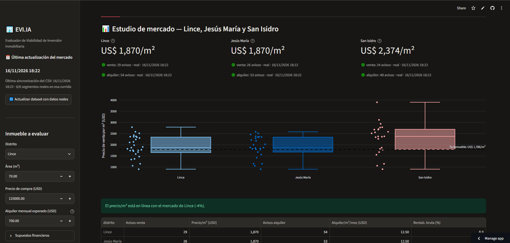
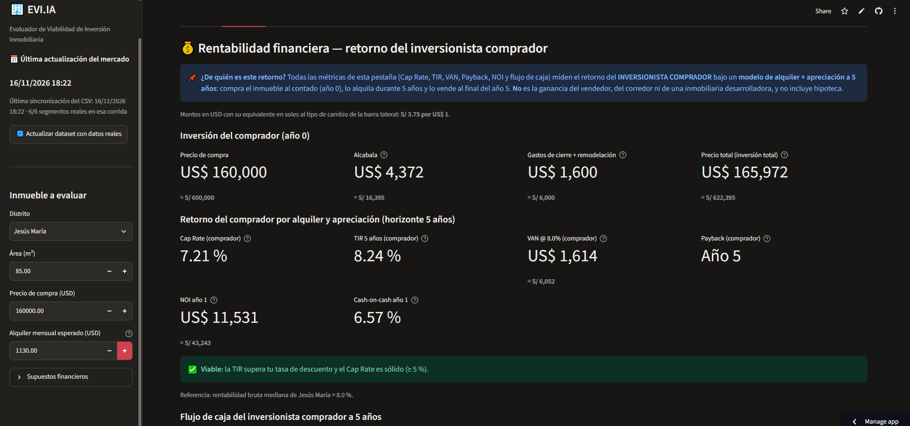
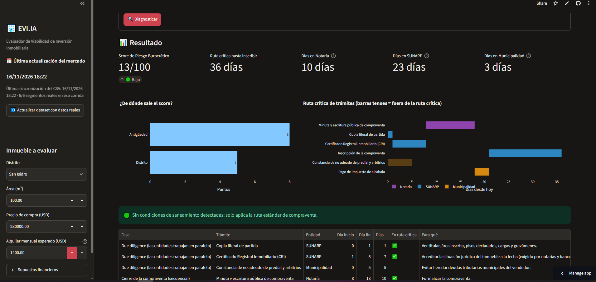
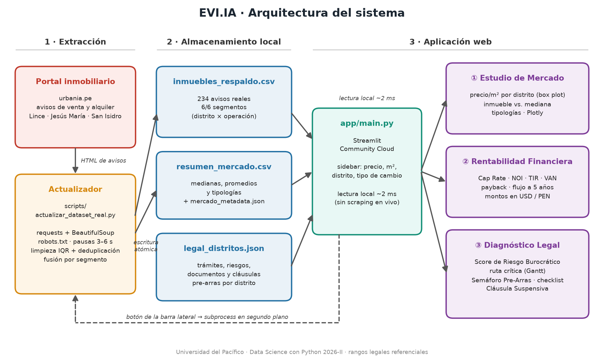
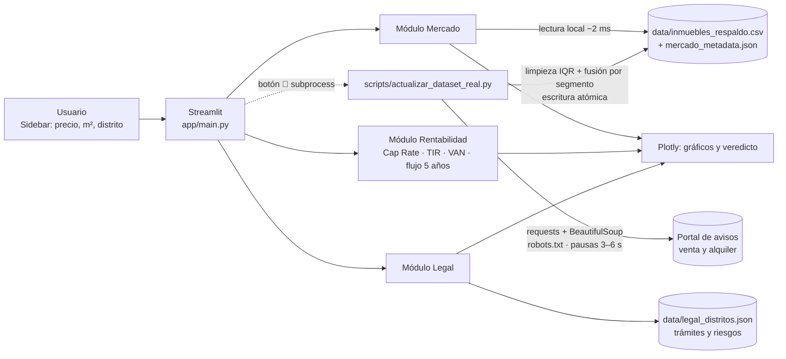

# EVI.IA — Evaluador de Viabilidad de Inversión Inmobiliaria con IA

## 1. One-liner
**EVI.IA transforma avisos inmobiliarios y datos financieros y legales en información estratégica para evaluar inversiones y anticipar riesgos antes de comprar una propiedad.**

## 2. Founder
| | |
|---|---|
|  | **Albert Randall Cruz Patiño** — Estudiante de Economía (menciones en Finanzas y Matemática), Universidad del Pacífico. Especializado en modelamiento financiero, valuación de activos y ciencia de datos aplicada al análisis de rentabilidad y riesgo inmobiliario en Lima. |

**Cómo cubro cada rol con agentes de IA**
- **Producto:** defino el flujo a partir de las entrevistas en [docs/research/](docs/research/); Claude Code me ayuda a priorizar.
- **Ingeniería:** Claude Code escribe y revisa el código (scraping, modelo financiero, app Streamlit); yo valido los cálculos y los entiendo línea por línea.
- **Diseño:** Streamlit + Plotly dan una interfaz limpia sin diseñador.
- **Ventas:** uso IA para redactar mensajes a corredores y grupos de inversionistas, y contenido para LinkedIn.

## 3. Problema
**Quién lo sufre:** profesionales y ahorristas de 30 a 55 años que quieren comprar **un** departamento para alquilar en Lince, Jesús María o San Isidro, y que no tienen un analista ni un abogado de cabecera.

**Cómo lo resuelven hoy:** revisan avisos a mano en portales, preguntan al corredor (que gana por vender) y, con suerte, arman un Excel con el alquiler esperado. Las verificaciones legales se hacen tarde, a veces ya con la arras firmada.

**Qué les cuesta:**
- **Horas:** los agentes dedican **de 30 min a 2 horas** por cada comparativo para un inversionista, entre abrir decenas de avisos y llamar a colegas para confirmar precios de cierre ([research](docs/research/sintesis_hallazgos.md)).
- **Soles:** costos que suelen omitirse: alcabala (3 % sobre el exceso de 10 UIT), gastos notariales y registrales, predial y arbitrios, vacancia, impuesto a la renta de 1.ª categoría.
- **Errores:** comprar inmuebles con fábrica no declarada, sin independizar o con cargas en SUNARP, cuya regularización puede tomar meses.

### Validación con usuarios (User Research)
Hicimos 3 entrevistas cualitativas a agentes inmobiliarios independientes, una por distrito objetivo, en noviembre de 2026. 📊 **[Síntesis de hallazgos →](docs/research/sintesis_hallazgos.md)**

| # | Entrevistada | Distrito | Hallazgo principal | Disposición a pagar | Transcripción |
|---|---|---|---|---|---|
| 1 | Agente A · independiente | Lince | Precios publicados inflados (pide US$ 120k → cierra US$ 105k); pisos sin declaratoria de fábrica y **9 meses** para independizar | S/ 15–20 por reporte | [entrevista_01](docs/research/entrevista_01_agente_a_lince.md) |
| 2 | Agente B · ex banca | Jesús María | Los clientes olvidan alcabala, IR y vacancia; sucesiones sin inscribir y **~1 año** para independizar: "ahí es donde se caen las comisiones" | S/ 60–80/mes o S/ 20 por consulta | [entrevista_02](docs/research/entrevista_02_agente_b_jesus_maria.md) |
| 3 | Agente C · medio-alto y corporativo | San Isidro | m² cambia por cuadra; mantenimiento de S/ 600–900/mes; multas municipales e hipotecas mal levantadas traban operaciones | S/ 100–150/mes | [entrevista_03](docs/research/entrevista_03_agente_c_san_isidro.md) |

**Qué validamos:** ninguna agente pagaría solo por calcular la rentabilidad, porque ya tienen su Excel. El dolor por el que sí pagan es **evitar que una operación se caiga por problemas legales o municipales antes de firmar arras**. Esto justifica el motor de rentabilidad neta (alcabala, IR, vacancia, mantenimiento) y el submódulo **Pre-Arras** (semáforo, checklist documental y cláusula suspensiva).

## 4. Solución e insight
**Qué construimos:** una app web con tres módulos que trabajan sobre el mismo inmueble (precio, m² y distrito ingresados en la barra lateral):

1. **📊 Estudio de mercado:** dataset local de avisos **reales de venta y alquiler** (Lince, Jesús María, San Isidro) que la app lee al instante, sin depender de la red durante el demo. Un script lo actualiza con scraping responsable y la app lo puede lanzar en segundo plano desde la barra lateral, mostrando la **fecha de la última actualización del mercado**. Compara tu precio/m² con la mediana del distrito, calcula la rentabilidad bruta (alquiler/m² ÷ precio/m²) y muestra la distribución por tipología.
2. **💰 Rentabilidad financiera (del inversionista comprador):** mide el retorno de quien **compra para alquilar 5 años y vender al año 5**. Calcula inversión total (precio + alcabala + gastos de cierre + remodelación), **Cap Rate**, NOI, cash-on-cash, **flujo de caja a 5 años**, **TIR**, **VAN** y payback, con un veredicto: viable / con reservas / no viable. Los montos se muestran en **USD y soles (PEN)** según el tipo de cambio de la barra lateral.
3. **⚖️ Alertas legales y permisos:** base local estructurada con los trámites (SUNARP, municipalidad, notaría), sus plazos estimados y los riesgos de saneamiento típicos de cada distrito. Un **formulario de diagnóstico** (antigüedad, independización en SUNARP, uso inscrito vs. previsto, pisos construidos vs. declarados, cargas, deudas, sucesión) calcula un **Score de Riesgo Burocrático (0-100)** con su desglose por factor, y una **ruta crítica** en días con el aporte de **Notaría, SUNARP y Municipalidad** (diagrama de Gantt, escenario optimista o conservador). Para brókeres, antes del **contrato de arras**: distingue proyecto en planos / entrega reciente (alerta de retraso en la independización) de inmueble de segundo uso, entrega un **Semáforo Pre-Arras** (🟢 viable / 🟡 solo con cláusula suspensiva / 🔴 no firmar hasta sanear), un **checklist documental dinámico** (CRI, copia literal, HR/PU, no adeudo, vigencia de poder, sucesión, levantamiento de hipoteca…) y una **cláusula suspensiva** autocompletada con el distrito, el precio (en números y letras) y los reparos detectados, con devolución del 100 % de las arras.

**Insight:** el inversionista minorista no pierde dinero por elegir mal el distrito, sino por **lo que no ve en la hoja de cálculo**: costos de transacción, vacancia, impuestos y, sobre todo, **riesgo registral**. Un inmueble "barato" respecto a la mediana suele estar barato por un problema de saneamiento. EVI.IA pone mercado, finanzas y legal en la misma pantalla para que esa conexión salte a la vista.

## 5. Why now
- **Datos abiertos y online:** los portales inmobiliarios concentran miles de avisos públicos y SUNARP ofrece publicidad registral en línea. Hace pocos años esa información estaba dispersa o en papel.
- **Herramientas de una sola persona:** con Python, Streamlit y hosting gratuito, más agentes de código como Claude Code, un founder puede construir y desplegar el producto en días.
- **Más inversionistas pequeños:** cada vez más personas buscan en el inmueble una alternativa de inversión y deciden sin asesoría profesional.

## 6. Demo
- **URL pública:** https://evi-ia-5jepleabk9543khyyufpzw.streamlit.app
- **Cómo correrlo localmente:**
  ```bash
  python -m venv .venv
  # Windows: .venv\Scripts\activate   |   macOS/Linux: source .venv/bin/activate
  pip install -r requirements.txt
  cp .env.example .env        # opcional
  streamlit run app/main.py
  ```
- **Actualizar el dataset de mercado** (≈1 min; también desde el botón 🔄 de la barra lateral):
  ```bash
  python scripts/actualizar_dataset_real.py              # motor requests (por defecto)
  python scripts/actualizar_dataset_real.py --paginas 3  # más avisos (máx. 5, según robots.txt)
  ```
- **Capturas del flujo principal:**

| 📊 1. Estudio de mercado | 💰 2. Rentabilidad financiera | ⚖️ 3. Diagnóstico legal |
|:---:|:---:|:---:|
|  |  |  |
| Precio/m² por distrito y comparación del inmueble | KPIs, veredicto y flujo de caja a 5 años | Score de Riesgo Burocrático, ruta crítica en Gantt y semáforo pre-arras |

**Arquitectura**



<details><summary>Versión Mermaid (texto)</summary>



</details>

**Modelos / APIs y por qué:**
- **Sin APIs de pago ni LLM en el MVP:** el costo marginal por usuario es casi cero y no se envían datos del inversionista a terceros.
- **La app no hace scraping en vivo:** lee `data/inmuebles_respaldo.csv`, que tarda unos 2 ms. Un HTTP 403 o una caída del portal no afectan el demo.
- **Actualizador ([scripts/actualizar_dataset_real.py](scripts/actualizar_dataset_real.py)):** usa `requests` + `BeautifulSoup`, respeta `robots.txt` (incluido el formato de paginación permitido), hace pausas aleatorias de 3 a 6 s y se identifica con un User-Agent honesto. Limpia los datos (deduplicación por ID de aviso, outliers de precio/m² por 1.5×IQR) y genera `data/resumen_mercado.csv` con medianas, promedios y distribución por tipología.
- **Scraping responsable:** si el portal responde con un desafío anti-bot (Cloudflare), **no se intenta evadirlo**. Se reintenta como máximo 2 veces y ese segmento (distrito × operación) conserva sus datos previos, así que el CSV nunca empeora. Hay un motor opcional con Selenium headless en configuración estándar (`--motor selenium`, `requirements-scraper.txt`). Hoy ese motor recibe el desafío de Cloudflare y por eso no es el motor por defecto.
- **Base sintética inicial:** [scripts/generar_respaldo.py](scripts/generar_respaldo.py) crea el último respaldo si nunca se corrió el actualizador. La app indica qué segmentos son reales y cuáles sintéticos.

## 7. Modelo de negocio
**Modelo Híbrido Validado en Campo**

| Plan | Precio | Para quién | Incluye | Validado por |
|---|---|---|---|---|
| **Pay-per-Use: Reporte Pre-Arras** | **S/ 15 – S/ 20 por consulta** | Agentes independientes de alta rotación en segmentos medios | Auditoría de riesgos legales y municipales (semáforo, checklist documental, cláusula suspensiva) y rentabilidad neta (alcabala, IR, vacancia) **justo antes de firmar el contrato de arras**, sin costos fijos mensuales | Agente A (Lince), Agente B (Jesús María) |
| **Suscripción Mensual Pro** | **S/ 60 – S/ 150 / mes** | Brókeres especializados y agencias en distritos de ticket alto | Evaluaciones recurrentes ilimitadas, mercado actualizado y reportes para varios inmuebles y clientes | Agente B (Jesús María), Agente C (San Isidro) |

> 🔁 **Iterado con User Research:** la primera versión del modelo era una suscripción rígida (S/ 29 y S/ 119 al mes). Las [entrevistas](docs/research/sintesis_hallazgos.md) mostraron que el agente independiente de segmento medio evita los pagos fijos ("meter otro pago fijo todos los meses me la pienso dos veces") pero sí paga S/ 15–20 por reporte cuando tiene un cliente a punto de firmar. En los distritos de ticket alto, en cambio, una comisión de US$ 6,000–10,000 justifica una suscripción de S/ 60–150. Pasamos a un **esquema híbrido** que **reduce la barrera de entrada** sin renunciar al ingreso recurrente.

**Costo por usuario (margen de contribución):**
- Tokens de IA: **S/ 0** (el MVP no usa LLM).
- Servidor: Streamlit Community Cloud gratis en el MVP. Al escalar, un VPS de ~US$ 10/mes compartido entre cientos de usuarios da **< S/ 0.50 por usuario/mes**.
- APIs de datos: S/ 0 (scraping de páginas públicas con caché).
- **Margen de contribución estimado: > 95 %** tanto por reporte como en la suscripción. El costo real está en adquisición (corredores y comunidades de inversionistas).

## 8. Herramientas del curso
| Herramienta del curso | Uso en el producto | Archivo |
|---|---|---|
| **Web scraping** (requests + BeautifulSoup) | Avisos de venta y alquiler por distrito, con pausas, robots.txt y fusión resiliente | [scripts/actualizar_dataset_real.py](scripts/actualizar_dataset_real.py): `parsear_pagina`, `extraer_segmento`, `limpiar`, `resumir` |
| **Dashboards** (Streamlit + Plotly) | App interactiva con sidebar, KPIs, gráficos y actualización en segundo plano | [app/main.py](app/main.py): `tab_mercado`, `tab_rentabilidad`, `tab_legal`, `sidebar_dataset` |
| Análisis de datos con pandas | Medianas por distrito, flujo de caja, TIR/VAN | [app/main.py](app/main.py): `referencias_distrito`, `calcular_rentabilidad` |

## 9. Qué hizo el agente
**Claude Code** (Anthropic) generó o ayudó a escribir:
- La estructura del repo (`app/`, `data/`, `docs/research/`, `scripts/`), `requirements.txt`, `.gitignore`, `.env.example` y `LICENSE`.
- `scripts/actualizar_dataset_real.py`: scraper responsable con pausas, limpieza IQR, fusión por segmento y metadata de sincronización.
- `app/main.py` completo: lectura local del dataset con actualización en segundo plano, modelo financiero (Cap Rate, alcabala, IR de 1.ª categoría, TIR por bisección, VAN, payback) e interfaz Streamlit.
- `scripts/generar_respaldo.py` y el CSV sintético de respaldo.
- `data/legal_distritos.json` (base referencial de trámites y riesgos).
- Las plantillas de entrevista y este README.

**Autoría y desarrollo:** Albert Randall Cruz Patiño — diseño integral de producto, entrevistas cualitativas de campo en Lince, Jesús María y San Isidro, desarrollo del scraper en Python, modelamiento financiero dual (USD/PEN), lógica de diagnóstico legal pre-arras, validación de supuestos y despliegue en Streamlit Community Cloud.

---

### Estructura del repo
```
.
├── app/main.py                 # app Streamlit (3 módulos)
├── data/
│   ├── inmuebles_respaldo.csv  # avisos de venta y alquiler (reales o sintéticos)
│   ├── resumen_mercado.csv     # medianas por distrito × operación × tipología
│   ├── mercado_metadata.json   # última sincronización y estado por segmento
│   └── legal_distritos.json    # trámites y riesgos por distrito
├── docs/
│   ├── arquitectura.png        # diagrama de arquitectura
│   ├── Foto.png                # foto del founder
│   ├── Captura_mercado.PNG     # captura: estudio de mercado
│   ├── Captura_rentabilidad.PNG  # captura: rentabilidad financiera
│   ├── Captura_legal.PNG       # captura: diagnóstico legal
│   └── research/               # 3 entrevistas a agentes + síntesis de hallazgos
├── scripts/
│   ├── actualizar_dataset_real.py  # scraping responsable → CSV
│   └── generar_respaldo.py         # base sintética inicial
├── .env.example  ·  .gitignore  ·  LICENSE (MIT)  ·  requirements.txt  ·  requirements-scraper.txt
└── README.md
```

> ⚖️ **Aviso:** EVI.IA es una herramienta de apoyo. Los plazos, montos y riesgos legales son referenciales y no reemplazan la revisión de SUNARP, la municipalidad, un notario o un abogado.
